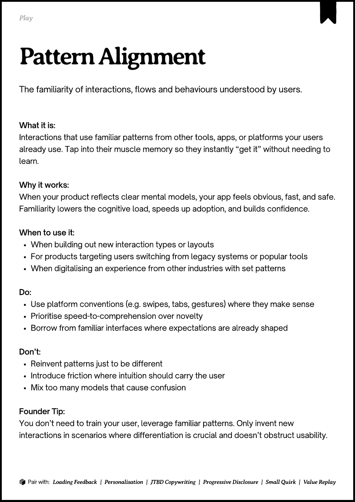

# PDF page 202

Source: `docs/ProductDesignPlaybook_V2.0.pdf`, page 202 of 206.

[Open the full-page screenshot](../../screenshots/page-202.jpg)



## Extracted text

```text
􀉟

Play

The familiarity of interactions, flows and behaviours understood by users.

What it is:

Interactions that use familiar patterns from other tools, apps, or platforms your users
already use. Tap into their muscle memory so they instantly “get it” without needing to
learn.


Why it works:

When your product reflects clear mental models, your app feels obvious, fast, and safe.
Familiarity lowers the cognitive load, speeds up adoption, and builds confidence.


When to use it:

When building out new interaction types or layouts

For products targeting users switching from legacy systems or popular tools

When digitalising an experience from other industries with set patterns


Do:

Use platform conventions (e.g. swipes, tabs, gestures) where they make sense

Prioritise speed-to-comprehension over novelty

Borrow from familiar interfaces where expectations are already shaped


Don’t:

Reinvent patterns just to be different

Introduce friction where intuition should carry the user

Mix too many models that cause confusion


Founder Tip:

You don’t need to train your user, leverage familiar patterns. Only invent new
interactions in scenarios where differentiation is crucial and doesn’t obstruct usability.

􀰴 Pair with:

Loading Feedback

| Personalisation |

JTBD Copywriting

|

Progressive Disclosure

| Small Quirk |

Value Replay
```
