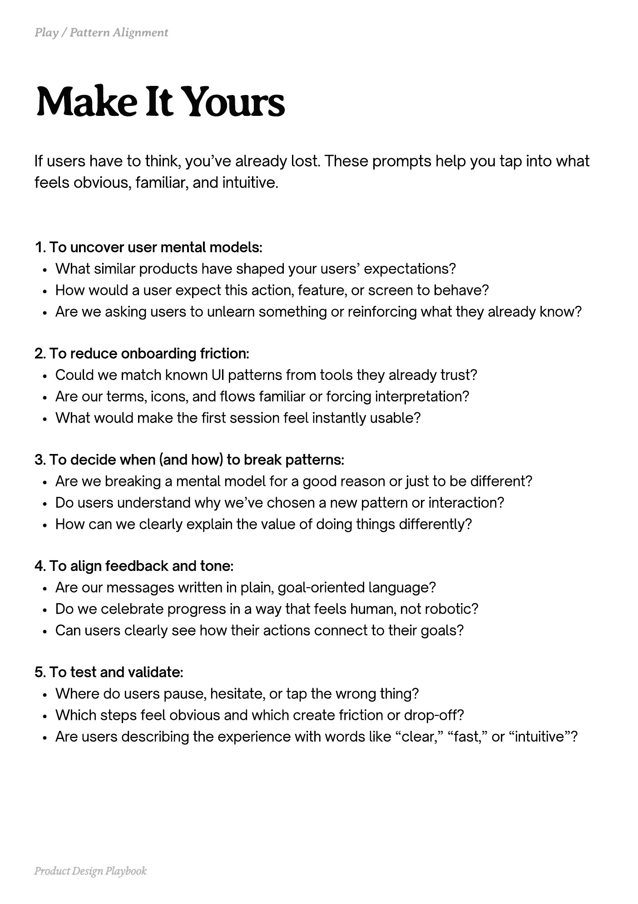

# PDF page 203

Source: `docs/ProductDesignPlaybook_V2.0.pdf`, page 203 of 206.

[Open the full-page screenshot](../../screenshots/page-203.jpg)



## Extracted text

```text
If users have to think, you’ve already lost. These prompts help you tap into what
feels obvious, familiar, and intuitive.
1. To uncover user mental models:

What similar products have shaped your users’ expectations?

How would a user expect this action, feature, or screen to behave?

Are we asking users to unlearn something or reinforcing what they already know?


2. To reduce onboarding friction:

Could we match known UI patterns from tools they already trust?

Are our terms, icons, and flows familiar or forcing interpretation?

What would make the first session feel instantly usable?


3. To decide when (and how) to break patterns:

Are we breaking a mental model for a good reason or just to be different?

Do users understand why we’ve chosen a new pattern or interaction?

How can we clearly explain the value of doing things differently?


4. To align feedback and tone:

Are our messages written in plain, goal-oriented language?

Do we celebrate progress in a way that feels human, not robotic?

Can users clearly see how their actions connect to their goals?


5. To test and validate:

Where do users pause, hesitate, or tap the wrong thing?

Which steps feel obvious and which create friction or drop-off?

Are users describing the experience with words like “clear,” “fast,” or “intuitive”?

Product Design Playbook
```
