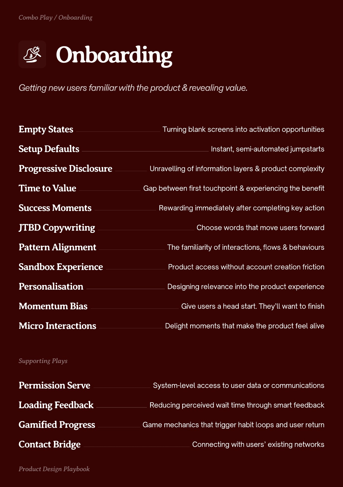
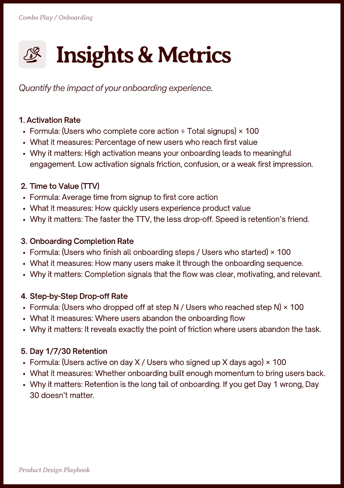
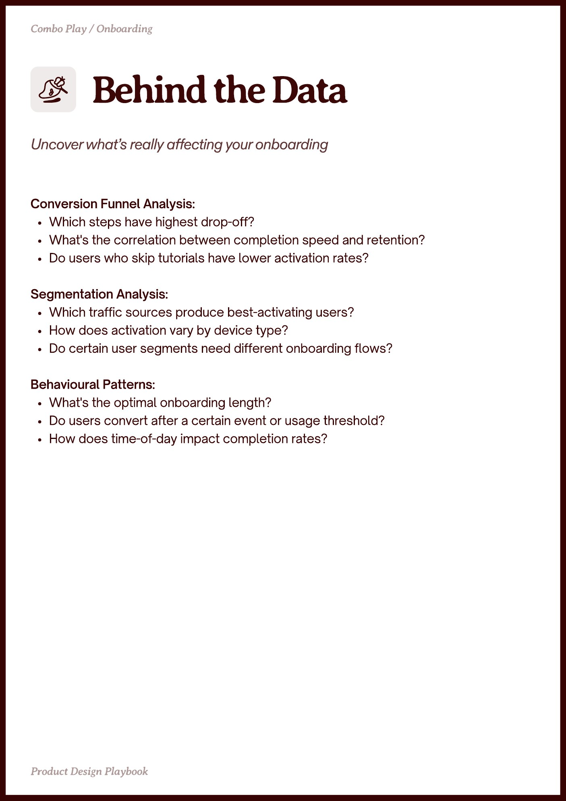

# Onboarding


Source-faithful grouping of PDF pages 6 through 8.


## Play stack, PDF page 6

[Open extracted page text](../source/pages/page-006.md) | [Open full-page screenshot](../screenshots/page-006.jpg)



### Extracted text

```text
nboarding

Empty States
Setup Defaults
Progressive Disclosure
Time to Value

Turning blank screens into activation opportunities
Instant, semi-automated jumpstarts
Unravelling of information layers & product complexity
Gap between first touchpoint & experiencing the benefit

Success Moments

Rewarding immediately after completing key action

JTBD Copywriting

Choose words that move users forward

Pattern Alignment

The familiarity of interactions, flows & behaviours

Sandbox Experience

Product access without account creation friction

Personalisation

Designing relevance into the product experience

Momentum Bias

Give users a head start. They’ll want to finish

Micro Interactions

Delight moments that make the product feel alive

Permission Serve

System-level access to user data or communications

Loading Feedback

Reducing perceived wait time through smart feedback

Gamified Progress

Game mechanics that trigger habit loops and user return

Contact Bridge

Connecting with users’ existing networks
```

## Insights and metrics, PDF page 7

[Open extracted page text](../source/pages/page-007.md) | [Open full-page screenshot](../screenshots/page-007.jpg)



### Extracted text

```text
1. Activation Rate

Formula: (Users who complete core action ÷ Total signups) × 100

What it measures: Percentage of new users who reach first value

Why it matters: High activation means your onboarding leads to meaningful
engagement. Low activation signals friction, confusion, or a weak first impression.


Time to Value (TTV)

Formula: Average time from signup to first core action

What it measures: How quickly users experience product value

Why it matters: The faster the TTV, the less drop-off. Speed is retention’s friend.


Onboarding Completion Rate

Formula: (Users who finish all onboarding steps / Users who started) × 100

What it measures: How many users make it through the onboarding sequence.

Why it matters: Completion signals that the flow was clear, motivating, and relevant.


Step-by-Step Drop-off Rate

Formula: (Users who dropped off at step N / Users who reached step N) × 100

What it measures: Where users abandon the onboarding flow

Why it matters: It reveals exactly the point of friction where users abandon the task.


Day 1/7/30 Retention

Formula: (Users active on day X / Users who signed up X days ago) × 100

What it measures: Whether onboarding built enough momentum to bring users back.

Why it matters: Retention is the long tail of onboarding. If you get Day 1 wrong, Day
30 doesn’t matter.
```

## Behind the data, PDF page 8

[Open extracted page text](../source/pages/page-008.md) | [Open full-page screenshot](../screenshots/page-008.jpg)



### Extracted text

```text
Conversion Funnel Analysis:

Which steps have highest drop-off?

What's the correlation between completion speed and retention?

Do users who skip tutorials have lower activation rates?


Segmentation Analysis:

Which traffic sources produce best-activating users?

How does activation vary by device type?

Do certain user segments need different onboarding flows?


Behavioural Patterns:

What's the optimal onboarding length?

Do users convert after a certain event or usage threshold?

How does time-of-day impact completion rates?
```
