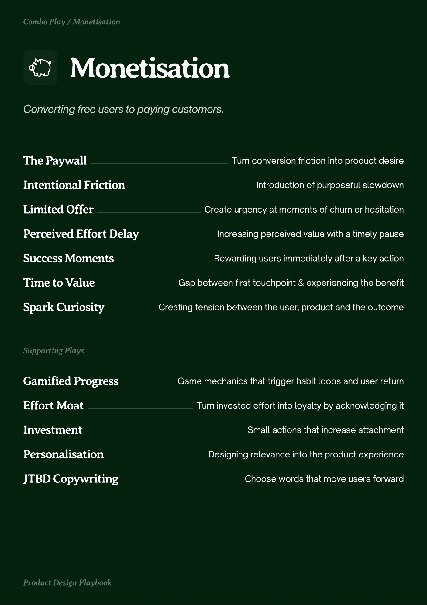
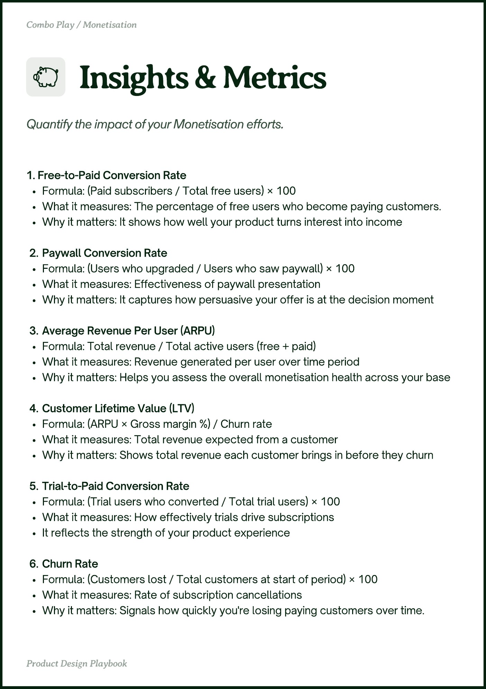
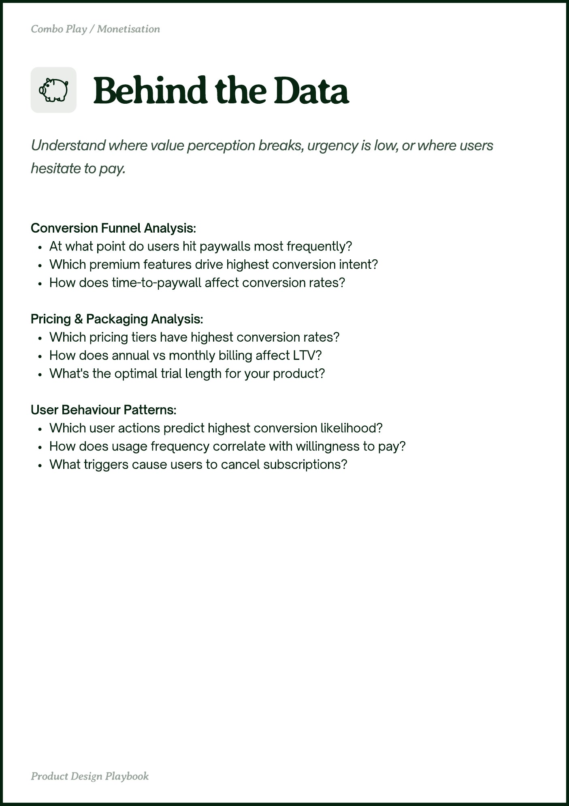

# Monetisation


Source-faithful grouping of PDF pages 9 through 11.


## Play stack, PDF page 9

[Open extracted page text](../source/pages/page-009.md) | [Open full-page screenshot](../screenshots/page-009.jpg)



### Extracted text

```text
Monetisation

The Paywall
Intentional Friction
Limited Offer

Turn conversion friction into product desire

Introduction of purposeful slowdown

Create urgency at moments of churn or hesitation

Perceived Effort Delay

Increasing perceived value with a timely pause

Success Moments

Rewarding users immediately after a key action

Time to Value
Spark Curiosity

Gamified Progress

Gap between first touchpoint & experiencing the benefit

Creating tension between the user, product and the outcome

Game mechanics that trigger habit loops and user return

Effort Moat

Turn invested effort into loyalty by acknowledging it

Investment

Small actions that increase attachment

Personalisation
JTBD Copywriting

Designing relevance into the product experience

Choose words that move users forward
```

## Insights and metrics, PDF page 10

[Open extracted page text](../source/pages/page-010.md) | [Open full-page screenshot](../screenshots/page-010.jpg)



### Extracted text

```text
1. Free-to-Paid Conversion Rate


Formula: (Paid subscribers / Total free users) × 100


What it measures: The percentage of free users who become paying customers.


Why it matters: It shows how well your product turns interest into income


Paywall Conversion Rate


Formula: (Users who upgraded / Users who saw paywall) × 100


What it measures: Effectiveness of paywall presentation


Why it matters: It captures how persuasive your offer is at the decision moment



Average Revenue Per User (ARPU)


Formula: Total revenue / Total active users (free + paid)


What it measures: Revenue generated per user over time period


Why it matters: Helps you assess the overall monetisation health across your base



Customer Lifetime Value (LTV)


Formula: (ARPU × Gross margin %) / Churn rate


What it measures: Total revenue expected from a customer


Why it matters: Shows total revenue each customer brings in before they churn



Trial-to-Paid Conversion Rate


Formula: (Trial users who converted / Total trial users) × 100


What it measures: How effectively trials drive subscriptions


It reflects the strength of your product experience


Churn Rate


Formula: (Customers lost / Total customers at start of period) × 100


What it measures: Rate of subscription cancellations


Why it matters: Signals how quickly you're losing paying customers over time.
```

## Behind the data, PDF page 11

[Open extracted page text](../source/pages/page-011.md) | [Open full-page screenshot](../screenshots/page-011.jpg)



### Extracted text

```text
Conversion Funnel Analysis:

At what point do users hit paywalls most frequently?

Which premium features drive highest conversion intent?

How does time-to-paywall affect conversion rates?


Pricing & Packaging Analysis:

Which pricing tiers have highest conversion rates?

How does annual vs monthly billing affect LTV?

What's the optimal trial length for your product?


User Behaviour Patterns:

Which user actions predict highest conversion likelihood?

How does usage frequency correlate with willingness to pay?

What triggers cause users to cancel subscriptions?
```
