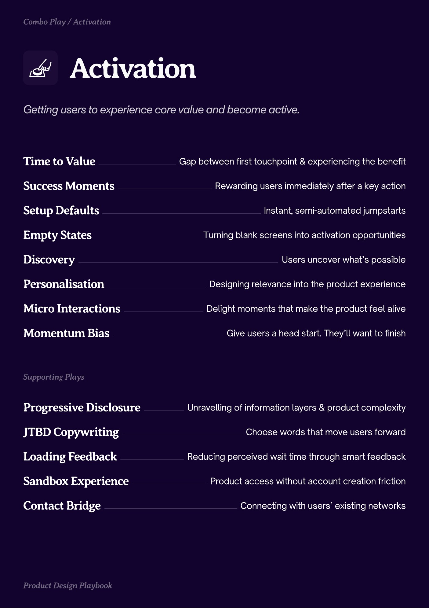
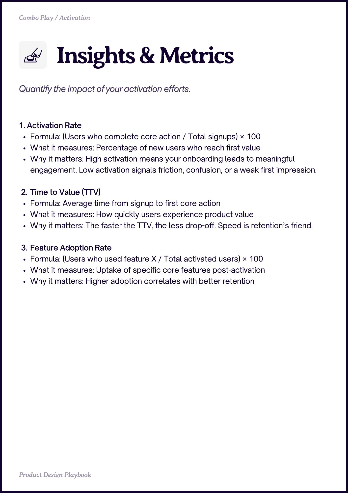
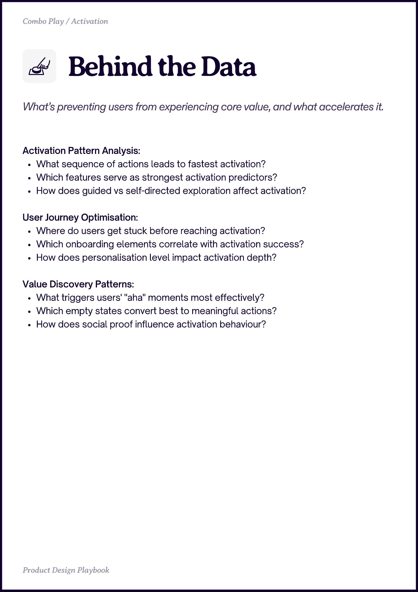

# Activation


Source-faithful grouping of PDF pages 12 through 14.


## Play stack, PDF page 12

[Open extracted page text](../source/pages/page-012.md) | [Open full-page screenshot](../screenshots/page-012.jpg)



### Extracted text

```text
ctivation
Time to Value
Success Moments
Setup Defaults
Empty States
Discovery

Gap between first touchpoint & experiencing the benefit
Rewarding users immediately after a key action
Instant, semi-automated jumpstarts
Turning blank screens into activation opportunities
Users uncover what’s possible

Personalisation

Designing relevance into the product experience

Micro Interactions

Delight moments that make the product feel alive

Momentum Bias

Progressive Disclosure
JTBD Copywriting

Loading Feedback
Sandbox Experience
Contact Bridge

Give users a head start. They’ll want to finish

Unravelling of information layers & product complexity

Choose words that move users forward
Reducing perceived wait time through smart feedback

Product access without account creation friction
Connecting with users’ existing networks
```

## Insights and metrics, PDF page 13

[Open extracted page text](../source/pages/page-013.md) | [Open full-page screenshot](../screenshots/page-013.jpg)



### Extracted text

```text
Insights & Metrics
1. Activation Rate

Formula: (Users who complete core action / Total signups) × 100

What it measures: Percentage of new users who reach first value

Why it matters: High activation means your onboarding leads to meaningful
engagement. Low activation signals friction, confusion, or a weak first impression.


Time to Value (TTV)

Formula: Average time from signup to first core action

What it measures: How quickly users experience product value

Why it matters: The faster the TTV, the less drop-off. Speed is retention’s friend.


Feature Adoption Rate

Formula: (Users who used feature X / Total activated users) × 100

What it measures: Uptake of specific core features post-activation

Why it matters: Higher adoption correlates with better retention
```

## Behind the data, PDF page 14

[Open extracted page text](../source/pages/page-014.md) | [Open full-page screenshot](../screenshots/page-014.jpg)



### Extracted text

```text
Behind the Data
Activation Pattern Analysis:

What sequence of actions leads to fastest activation?

Which features serve as strongest activation predictors?

How does guided vs self-directed exploration affect activation?


User Journey Optimisation:

Where do users get stuck before reaching activation?

Which onboarding elements correlate with activation success?

How does personalisation level impact activation depth?


Value Discovery Patterns:

What triggers users' "aha" moments most effectively?

Which empty states convert best to meaningful actions?

How does social proof influence activation behaviour?
```
