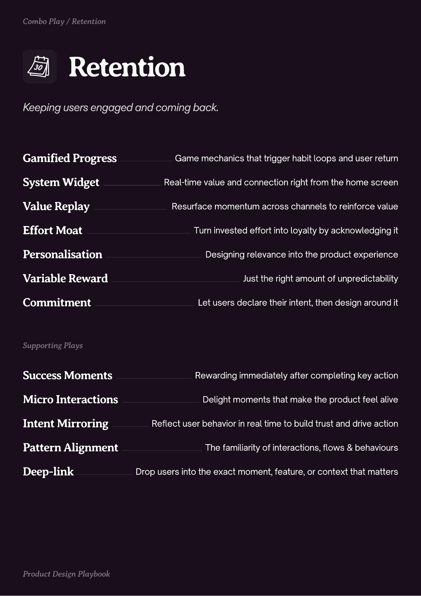
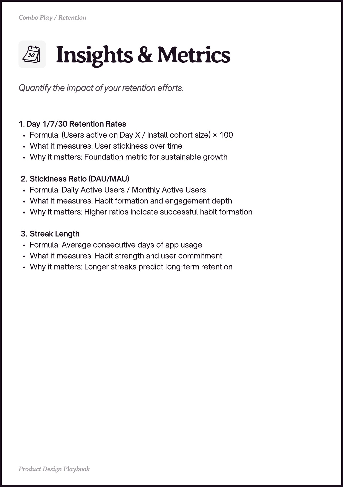
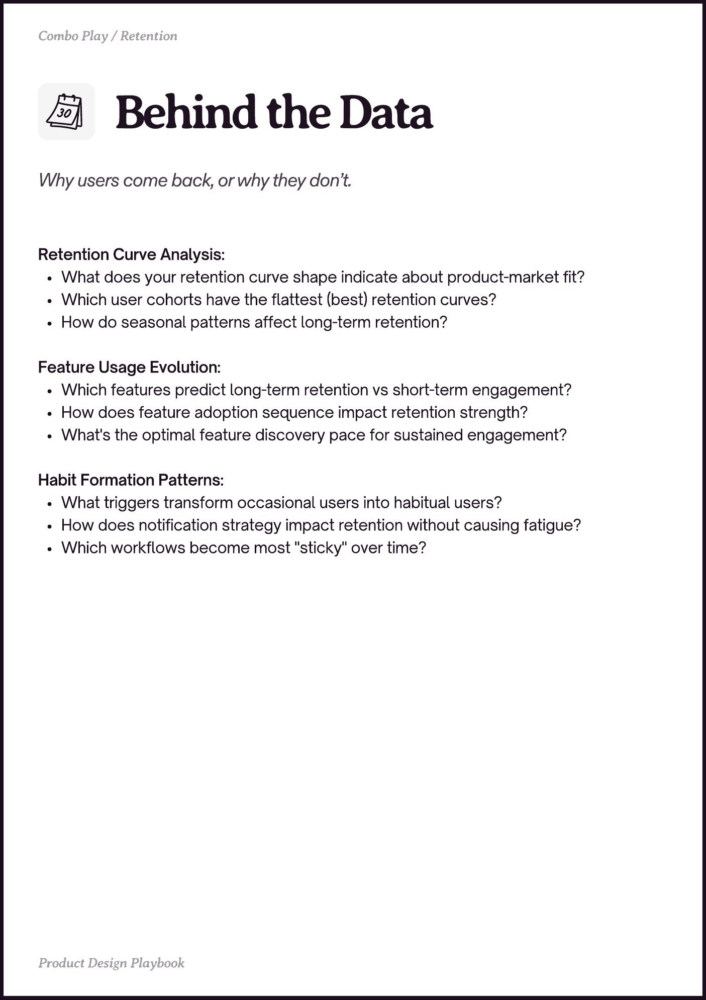

# Retention


Source-faithful grouping of PDF pages 15 through 17.


## Play stack, PDF page 15

[Open extracted page text](../source/pages/page-015.md) | [Open full-page screenshot](../screenshots/page-015.jpg)



### Extracted text

```text
Retention

Gamified Progress

Game mechanics that trigger habit loops and user return

System Widget

Real-time value and connection right from the home screen

Value Replay

Resurface momentum across channels to reinforce value

Effort Moat
Personalisation
Variable Reward

Turn invested effort into loyalty by acknowledging it
Designing relevance into the product experience
Just the right amount of unpredictability

Commitment

Let users declare their intent, then design around it

Success Moments

Rewarding immediately after completing key action

Micro Interactions

Delight moments that make the product feel alive

Intent Mirroring
Pattern Alignment
Deep-link

Reflect user behavior in real time to build trust and drive action
The familiarity of interactions, flows & behaviours
Drop users into the exact moment, feature, or context that matters
```

## Insights and metrics, PDF page 16

[Open extracted page text](../source/pages/page-016.md) | [Open full-page screenshot](../screenshots/page-016.jpg)



### Extracted text

```text
1. Day 1/7/30 Retention Rates

Formula: (Users active on Day X / Install cohort size) × 100

What it measures: User stickiness over time

Why it matters: Foundation metric for sustainable growth



Stickiness Ratio (DAU/MAU)

Formula: Daily Active Users / Monthly Active Users

What it measures: Habit formation and engagement depth

Why it matters: Higher ratios indicate successful habit formation



Streak Length

Formula: Average consecutive days of app usage

What it measures: Habit strength and user commitment

Why it matters: Longer streaks predict long-term retention
```

## Behind the data, PDF page 17

[Open extracted page text](../source/pages/page-017.md) | [Open full-page screenshot](../screenshots/page-017.jpg)



### Extracted text

```text
Retention Curve Analysis:

What does your retention curve shape indicate about product-market fit?

Which user cohorts have the flattest (best) retention curves?

How do seasonal patterns affect long-term retention?



Feature Usage Evolution:

Which features predict long-term retention vs short-term engagement?

How does feature adoption sequence impact retention strength?

What's the optimal feature discovery pace for sustained engagement?



Habit Formation Patterns:

What triggers transform occasional users into habitual users?

How does notification strategy impact retention without causing fatigue?

Which workflows become most "sticky" over time?
```
