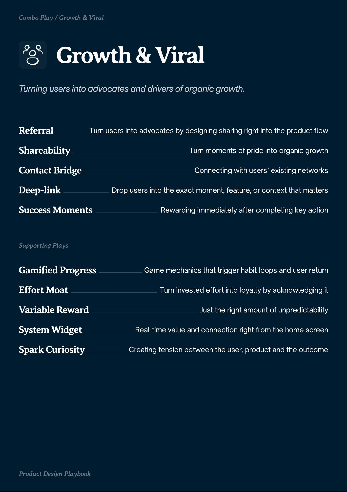
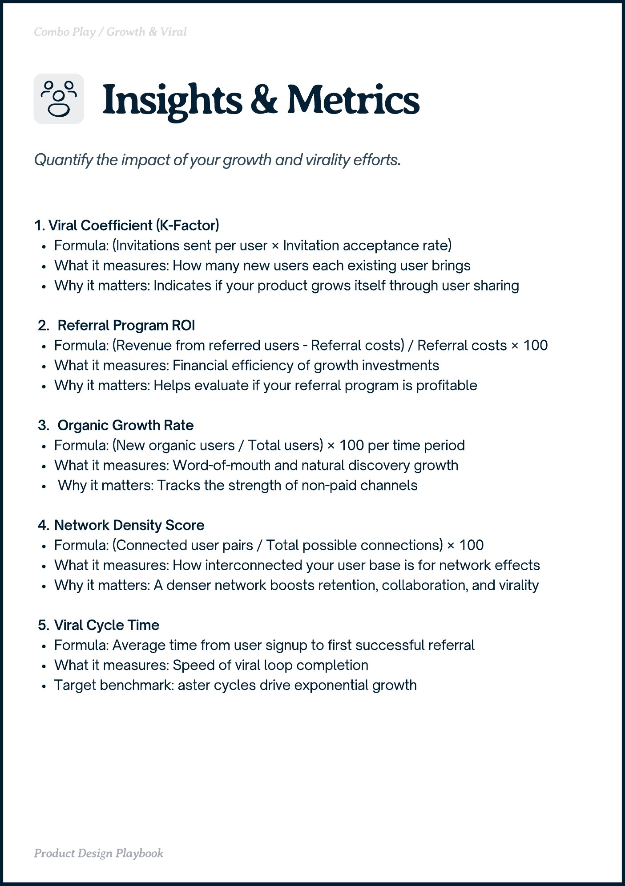
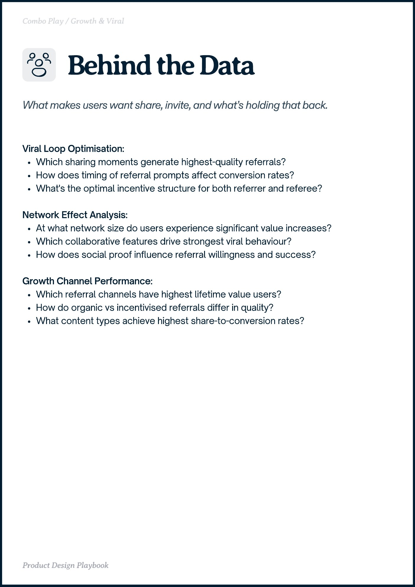

# Growth & Viral


Source-faithful grouping of PDF pages 18 through 20.


## Play stack, PDF page 18

[Open extracted page text](../source/pages/page-018.md) | [Open full-page screenshot](../screenshots/page-018.jpg)



### Extracted text

```text
Growth Viral
Referral

Turn users into advocates by designing sharing right into the product flow

Shareability
Contact Bridge
Deep-link

Turn moments of pride into organic growth
Connecting with users’ existing networks
Drop users into the exact moment, feature, or context that matters

Success Moments

Rewarding immediately after completing key action

Gamified Progress

Game mechanics that trigger habit loops and user return

Effort Moat
Variable Reward

Turn invested effort into loyalty by acknowledging it
Just the right amount of unpredictability

System Widget

Real-time value and connection right from the home screen

Spark Curiosity

Creating tension between the user, product and the outcome
```

## Insights and metrics, PDF page 19

[Open extracted page text](../source/pages/page-019.md) | [Open full-page screenshot](../screenshots/page-019.jpg)



### Extracted text

```text
obo Play rot iral

O

1. Viral Coefficient (K-Factor)

Formula: (Invitations sent per user × Invitation acceptance rate)

What it measures: How many new users each existing user brings

Why it matters: Indicates if your product grows itself through user sharing


Referral Program ROI

Formula: (Revenue from referred users - Referral costs) / Referral costs × 100

What it measures: Financial efficiency of growth investments

Why it matters: Helps evaluate if your referral program is profitable


Organic Growth Rate

Formula: (New organic users / Total users) × 100 per time period

What it measures: Word-of-mouth and natural discovery growth

Why it matters: Tracks the strength of non-paid channels


Network Density Score

Formula: (Connected user pairs / Total possible connections) × 100

What it measures: How interconnected your user base is for network effects

Why it matters: A denser network boosts retention, collaboration, and virality


Viral Cycle Time

Formula: Average time from user signup to first successful referral

What it measures: Speed of viral loop completion

Target benchmark: aster cycles drive exponential growth

Product Design Playbook
```

## Behind the data, PDF page 20

[Open extracted page text](../source/pages/page-020.md) | [Open full-page screenshot](../screenshots/page-020.jpg)



### Extracted text

```text
obo Play rot iral

Viral Loop Optimisation:

Which sharing moments generate highest-quality referrals?

How does timing of referral prompts affect conversion rates?

What's the optimal incentive structure for both referrer and referee?


Network Effect Analysis:

At what network size do users experience significant value increases?

Which collaborative features drive strongest viral behaviour?

How does social proof influence referral willingness and success?


Growth Channel Performance:

Which referral channels have highest lifetime value users?

How do organic vs incentivised referrals differ in quality?

What content types achieve highest share-to-conversion rates?

Product Design Playbook
```
