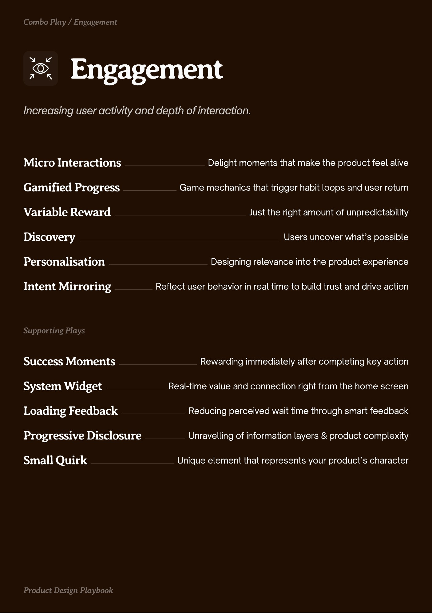
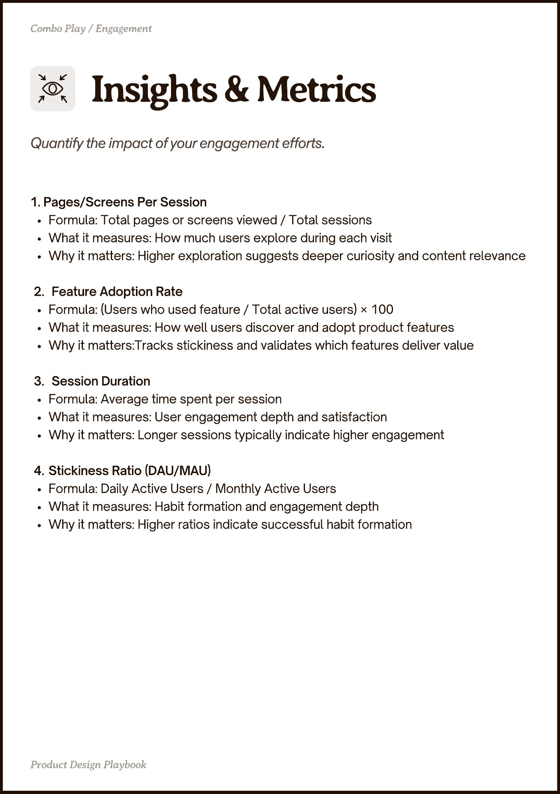
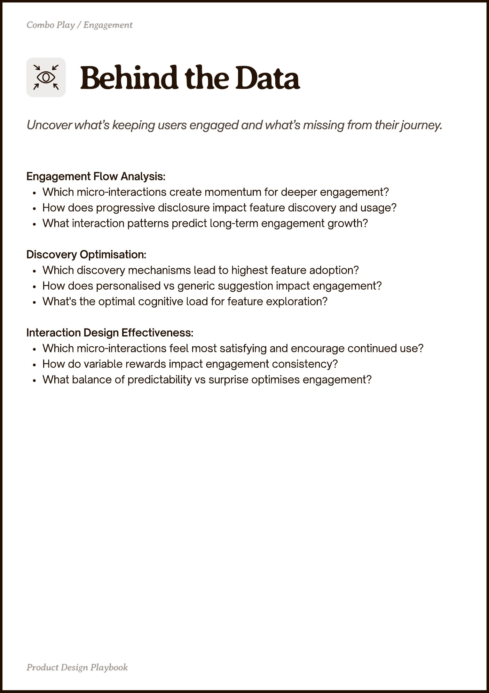

# Engagement


Source-faithful grouping of PDF pages 21 through 23.


## Play stack, PDF page 21

[Open extracted page text](../source/pages/page-021.md) | [Open full-page screenshot](../screenshots/page-021.jpg)



### Extracted text

```text
ngagement

Micro Interactions

Delight moments that make the product feel alive

Gamified Progress

Game mechanics that trigger habit loops and user return

Variable Reward
Discovery
Personalisation

Just the right amount of unpredictability
Users uncover what’s possible
Designing relevance into the product experience

Intent Mirroring

Reflect user behavior in real time to build trust and drive action

Success Moments

Rewarding immediately after completing key action

System Widget

Real-time value and connection right from the home screen

Loading Feedback

Reducing perceived wait time through smart feedback

Progressive Disclosure

Unravelling of information layers & product complexity

Small Quirk

Unique element that represents your product’s character
```

## Insights and metrics, PDF page 22

[Open extracted page text](../source/pages/page-022.md) | [Open full-page screenshot](../screenshots/page-022.jpg)



### Extracted text

```text
Combo Play / Engagement

1. Pages/Screens Per Session

Formula: Total pages or screens viewed / Total sessions

What it measures: How much users explore during each visit

Why it matters: Higher exploration suggests deeper curiosity and content relevance


Feature Adoption Rate

Formula: (Users who used feature / Total active users) × 100

What it measures: How well users discover and adopt product features

Why it matters:Tracks stickiness and validates which features deliver value


Session Duration

Formula: Average time spent per session

What it measures: User engagement depth and satisfaction

Why it matters: Longer sessions typically indicate higher engagement


Stickiness Ratio (DAU/MAU)

Formula: Daily Active Users / Monthly Active Users

What it measures: Habit formation and engagement depth

Why it matters: Higher ratios indicate successful habit formation

Pot egn Playboo
```

## Behind the data, PDF page 23

[Open extracted page text](../source/pages/page-023.md) | [Open full-page screenshot](../screenshots/page-023.jpg)



### Extracted text

```text
Combo Play / Engagement

Engagement Flow Analysis:

Which micro-interactions create momentum for deeper engagement?

How does progressive disclosure impact feature discovery and usage?

What interaction patterns predict long-term engagement growth?


Discovery Optimisation:

Which discovery mechanisms lead to highest feature adoption?

How does personalised vs generic suggestion impact engagement?

What's the optimal cognitive load for feature exploration?


Interaction Design Effectiveness:

Which micro-interactions feel most satisfying and encourage continued use?

How do variable rewards impact engagement consistency?

What balance of predictability vs surprise optimises engagement?

Pot egn Playboo
```
