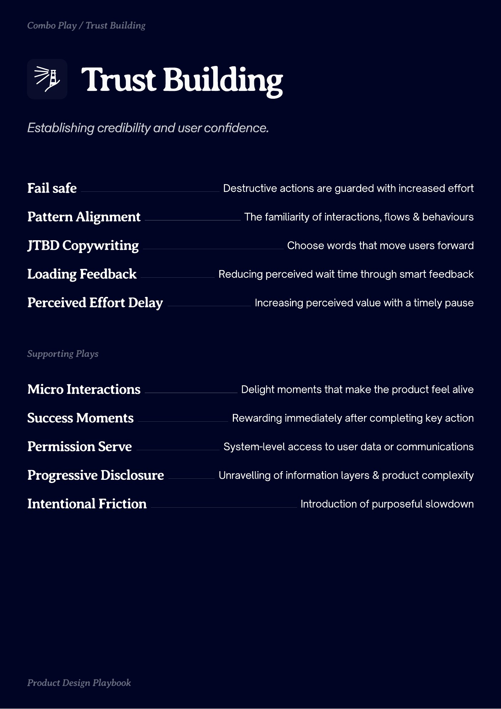
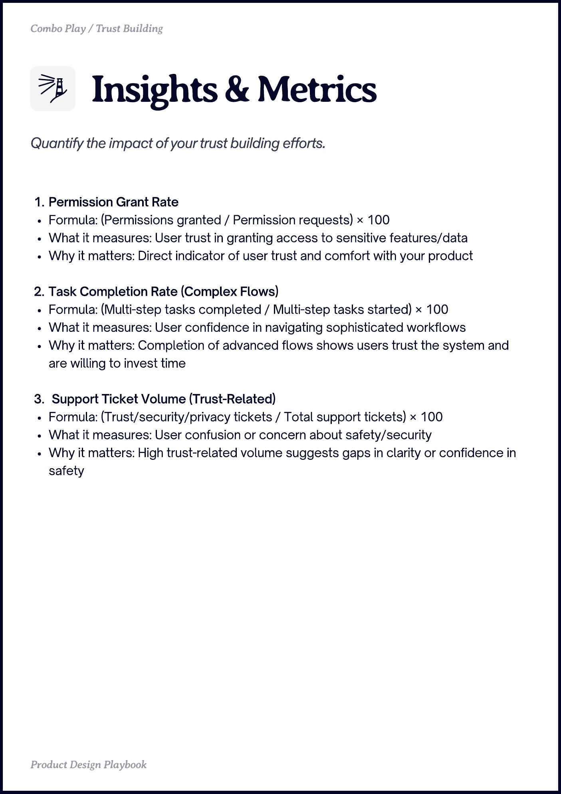
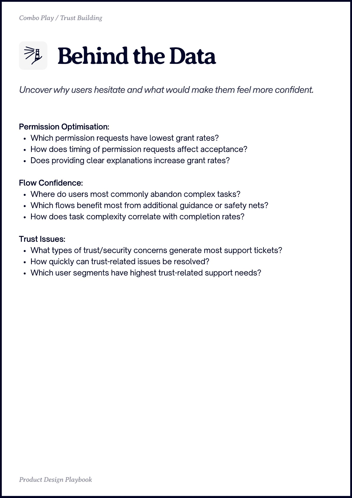

# Trust Building


Source-faithful grouping of PDF pages 24 through 26.


## Play stack, PDF page 24

[Open extracted page text](../source/pages/page-024.md) | [Open full-page screenshot](../screenshots/page-024.jpg)



### Extracted text

```text
Combo Play / Trust Building

Trust Building
Fail safe

Destructive actions are guarded with increased effort

Pattern Alignment

The familiarity of interactions, flows & behaviours

JTBD Copywriting

Choose words that move users forward

Loading Feedback

Reducing perceived wait time through smart feedback

Perceived Effort Delay

Increasing perceived value with a timely pause

urting ls

Micro Interactions

Delight moments that make the product feel alive

Success Moments

Rewarding immediately after completing key action

Permission Serve

System-level access to user data or communications

Progressive Disclosure

Unravelling of information layers & product complexity

Intentional Friction

rdut sign l

Introduction of purposeful slowdown
```

## Insights and metrics, PDF page 25

[Open extracted page text](../source/pages/page-025.md) | [Open full-page screenshot](../screenshots/page-025.jpg)



### Extracted text

```text
Combo Play / Trust Building

Permission Grant Rate

Formula: (Permissions granted / Permission requests) × 100

What it measures: User trust in granting access to sensitive features/data

Why it matters: Direct indicator of user trust and comfort with your product


Task Completion Rate (Complex Flows)

Formula: (Multi-step tasks completed / Multi-step tasks started) × 100

What it measures: User confidence in navigating sophisticated workflows

Why it matters: Completion of advanced flows shows users trust the system and
are willing to invest time


Support Ticket Volume (Trust-Related)

Formula: (Trust/security/privacy tickets / Total support tickets) × 100

What it measures: User confusion or concern about safety/security

Why it matters: High trust-related volume suggests gaps in clarity or confidence in
safety

Produt sign Playboo
```

## Behind the data, PDF page 26

[Open extracted page text](../source/pages/page-026.md) | [Open full-page screenshot](../screenshots/page-026.jpg)



### Extracted text

```text
Combo Play / Trust Building

Permission Optimisation:

Which permission requests have lowest grant rates?

How does timing of permission requests affect acceptance?

Does providing clear explanations increase grant rates?


Flow Confidence:

Where do users most commonly abandon complex tasks?

Which flows benefit most from additional guidance or safety nets?

How does task complexity correlate with completion rates?


Trust Issues:

What types of trust/security concerns generate most support tickets?

How quickly can trust-related issues be resolved?

Which user segments have highest trust-related support needs?

Produt sign Playboo
```
