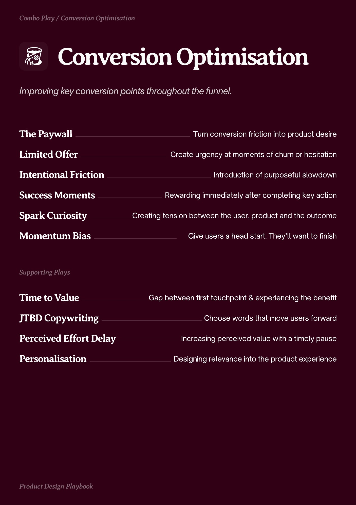
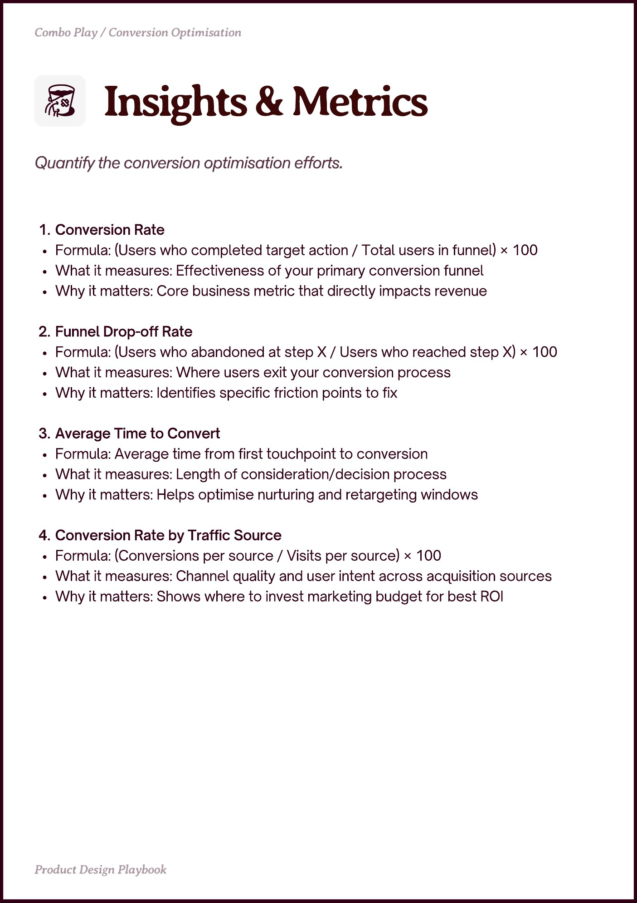
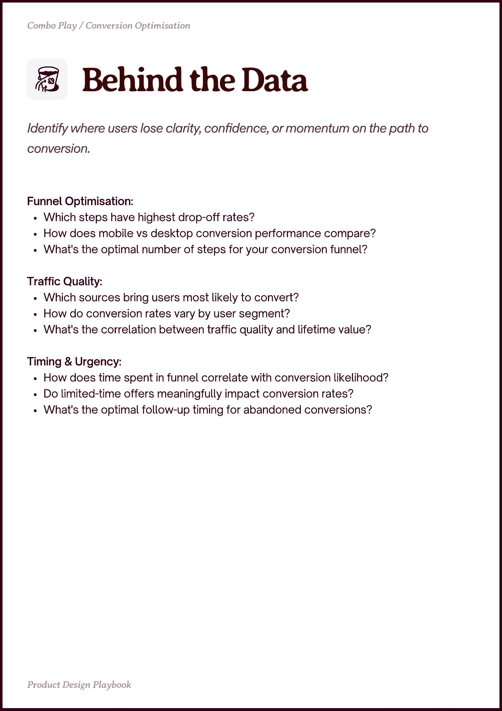

# Conversion Optimisation


Source-faithful grouping of PDF pages 27 through 29.


## Play stack, PDF page 27

[Open extracted page text](../source/pages/page-027.md) | [Open full-page screenshot](../screenshots/page-027.jpg)



### Extracted text

```text
Combo Play / Conversion Optimisation

Conversion Optimisation
The Paywall
Limited Offer
Intentional Friction
Success Moments

Turn conversion friction into product desire
Create urgency at moments of churn or hesitation
Introduction of purposeful slowdown
Rewarding immediately after completing key action

Spark Curiosity

Creating tension between the user, product and the outcome

Momentum Bias

Give users a head start. They’ll want to finish

pportin Plays

Time to Value
JTBD Copywriting
Perceived Effort Delay
Personalisation

Prot esin Playboo

Gap between first touchpoint & experiencing the benefit
Choose words that move users forward
Increasing perceived value with a timely pause

Designing relevance into the product experience
```

## Insights and metrics, PDF page 28

[Open extracted page text](../source/pages/page-028.md) | [Open full-page screenshot](../screenshots/page-028.jpg)



### Extracted text

```text
Combo Play / Conversion Optimisation

Conversion Rate

Formula: (Users who completed target action / Total users in funnel) × 100

What it measures: Effectiveness of your primary conversion funnel

Why it matters: Core business metric that directly impacts revenue


Funnel Drop-off Rate

Formula: (Users who abandoned at step X / Users who reached step X) × 100

What it measures: Where users exit your conversion process

Why it matters: Identifies specific friction points to fix


Average Time to Convert

Formula: Average time from first touchpoint to conversion

What it measures: Length of consideration/decision process

Why it matters: Helps optimise nurturing and retargeting windows


Conversion Rate by Traffic Source

Formula: (Conversions per source / Visits per source) × 100

What it measures: Channel quality and user intent across acquisition sources

Why it matters: Shows where to invest marketing budget for best ROI

Prot esin Playboo
```

## Behind the data, PDF page 29

[Open extracted page text](../source/pages/page-029.md) | [Open full-page screenshot](../screenshots/page-029.jpg)



### Extracted text

```text
Combo Play / Conversion Optimisation

Funnel Optimisation:

Which steps have highest drop-off rates?

How does mobile vs desktop conversion performance compare?

What's the optimal number of steps for your conversion funnel?


Traffic Quality:

Which sources bring users most likely to convert?

How do conversion rates vary by user segment?

What's the correlation between traffic quality and lifetime value?


Timing & Urgency:

How does time spent in funnel correlate with conversion likelihood?

Do limited-time offers meaningfully impact conversion rates?

What's the optimal follow-up timing for abandoned conversions?

Prot esin Playboo
```
