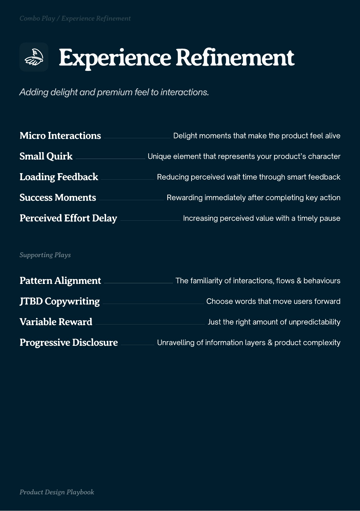
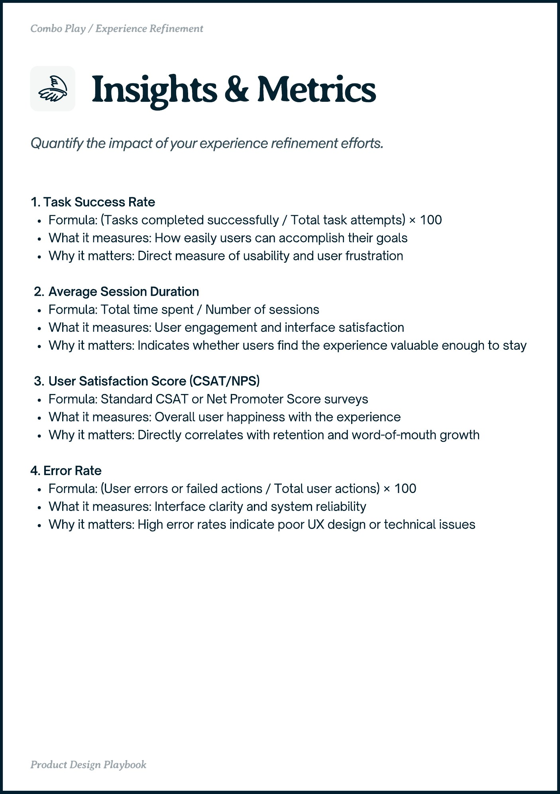
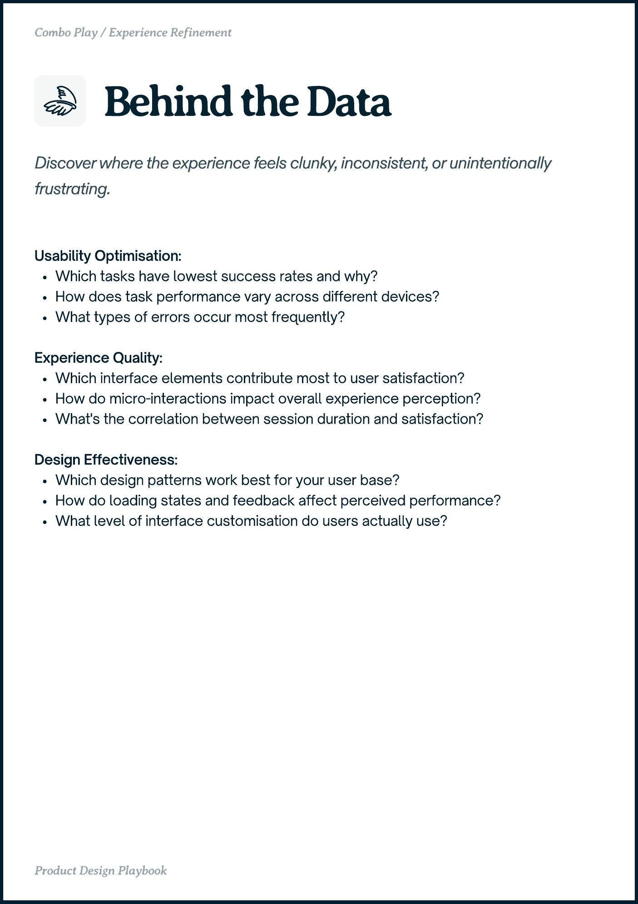

# Experience Refinement


Source-faithful grouping of PDF pages 30 through 32.


## Play stack, PDF page 30

[Open extracted page text](../source/pages/page-030.md) | [Open full-page screenshot](../screenshots/page-030.jpg)



### Extracted text

```text
Eperience Refinement

Micro Interactions
Small Quirk

Delight moments that make the product feel alive
Unique element that represents your product’s character

Loading Feedback

Reducing perceived wait time through smart feedback

Success Moments

Rewarding immediately after completing key action

Perceived Effort Delay

Increasing perceived value with a timely pause

Pattern Alignment

The familiarity of interactions, flows & behaviours

JTBD Copywriting

Choose words that move users forward

Variable Reward

Just the right amount of unpredictability

Progressive Disclosure

Unravelling of information layers & product complexity
```

## Insights and metrics, PDF page 31

[Open extracted page text](../source/pages/page-031.md) | [Open full-page screenshot](../screenshots/page-031.jpg)



### Extracted text

```text
Combo Play / Experience Refinement

1. Task Success Rate

Formula: (Tasks completed successfully / Total task attempts) × 100

What it measures: How easily users can accomplish their goals

Why it matters: Direct measure of usability and user frustration


Average Session Duration

Formula: Total time spent / Number of sessions

What it measures: User engagement and interface satisfaction

Why it matters: Indicates whether users find the experience valuable enough to stay


User Satisfaction Score (CSAT/NPS)

Formula: Standard CSAT or Net Promoter Score surveys

What it measures: Overall user happiness with the experience

Why it matters: Directly correlates with retention and word-of-mouth growth


4. Error Rate

Formula: (User errors or failed actions / Total user actions) × 100

What it measures: Interface clarity and system reliability

Why it matters: High error rates indicate poor UX design or technical issues

Proct ein Playboo
```

## Behind the data, PDF page 32

[Open extracted page text](../source/pages/page-032.md) | [Open full-page screenshot](../screenshots/page-032.jpg)



### Extracted text

```text
Combo Play / Experience Refinement

Usability Optimisation:

Which tasks have lowest success rates and why?

How does task performance vary across different devices?

What types of errors occur most frequently?


Experience Quality:

Which interface elements contribute most to user satisfaction?

How do micro-interactions impact overall experience perception?

What's the correlation between session duration and satisfaction?


Design Effectiveness:

Which design patterns work best for your user base?

How do loading states and feedback affect perceived performance?

What level of interface customisation do users actually use?

Proct ein Playboo
```
