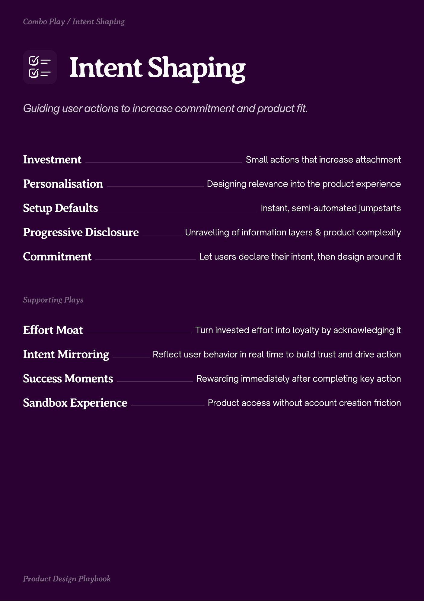
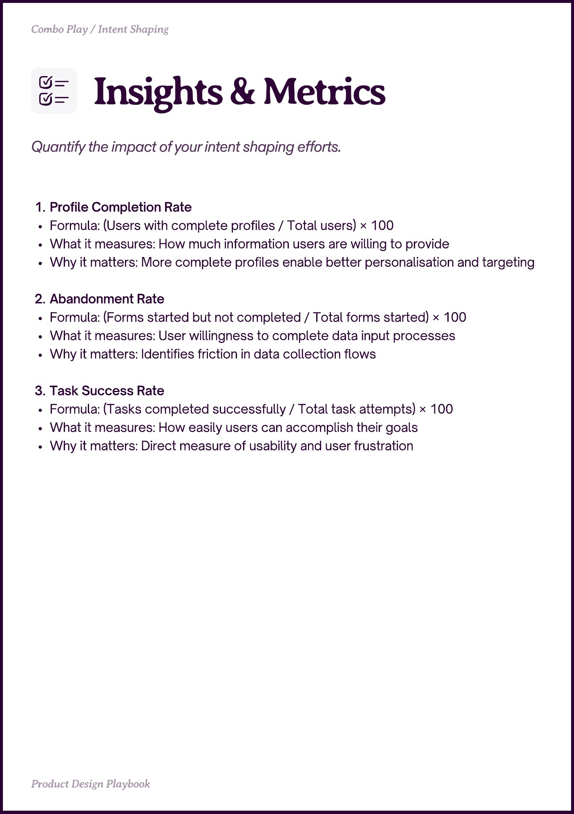
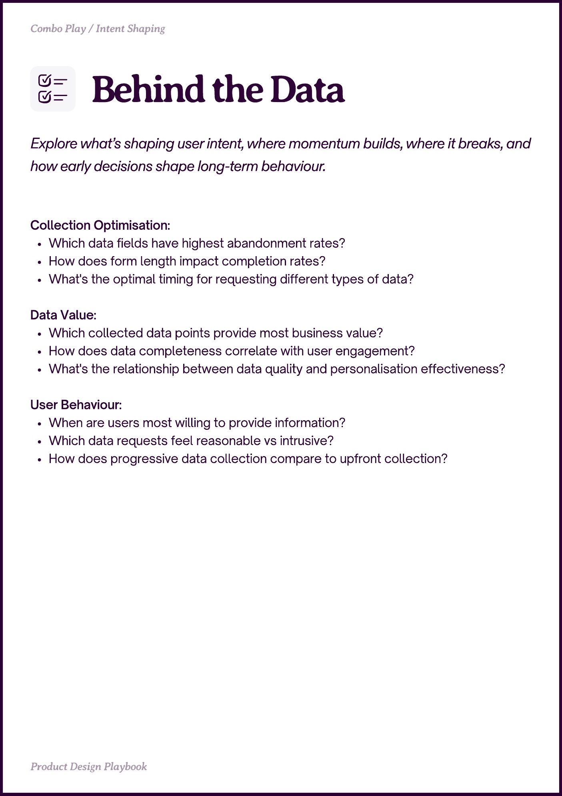

# Intent Shaping


Source-faithful grouping of PDF pages 33 through 35.


## Play stack, PDF page 33

[Open extracted page text](../source/pages/page-033.md) | [Open full-page screenshot](../screenshots/page-033.jpg)



### Extracted text

```text
Combo Play / Intent Shaping

Intent Saping
Investment

Small actions that increase attachment

Personalisation

Designing relevance into the product experience

Setup Defaults

Instant, semi-automated jumpstarts

Progressive Disclosure
Commitment

Unravelling of information layers & product complexity
Let users declare their intent, then design around it

Sppting a

Effort Moat

Turn invested effort into loyalty by acknowledging it

Intent Mirroring

Reflect user behavior in real time to build trust and drive action

Success Moments

Rewarding immediately after completing key action

Sandbox Experience

t eign a

Product access without account creation friction
```

## Insights and metrics, PDF page 34

[Open extracted page text](../source/pages/page-034.md) | [Open full-page screenshot](../screenshots/page-034.jpg)



### Extracted text

```text
Combo Play / Intent Shaping

Profile Completion Rate

Formula: (Users with complete profiles / Total users) × 100

What it measures: How much information users are willing to provide

Why it matters: More complete profiles enable better personalisation and targeting


Abandonment Rate

Formula: (Forms started but not completed / Total forms started) × 100

What it measures: User willingness to complete data input processes

Why it matters: Identifies friction in data collection flows


Task Success Rate

Formula: (Tasks completed successfully / Total task attempts) × 100

What it measures: How easily users can accomplish their goals

Why it matters: Direct measure of usability and user frustration

Pot eign Playboo
```

## Behind the data, PDF page 35

[Open extracted page text](../source/pages/page-035.md) | [Open full-page screenshot](../screenshots/page-035.jpg)



### Extracted text

```text
Combo Play / Intent Shaping

Explore what’s shaping user intent, where momentum builds, where it breaks, and
how early decisions shape long-term behaviour.
Collection Optimisation:

Which data fields have highest abandonment rates?

How does form length impact completion rates?

What's the optimal timing for requesting different types of data?


Data Value:

Which collected data points provide most business value?

How does data completeness correlate with user engagement?

What's the relationship between data quality and personalisation effectiveness?


User Behaviour:

When are users most willing to provide information?

Which data requests feel reasonable vs intrusive?

How does progressive data collection compare to upfront collection?

Pot eign Playboo
```
