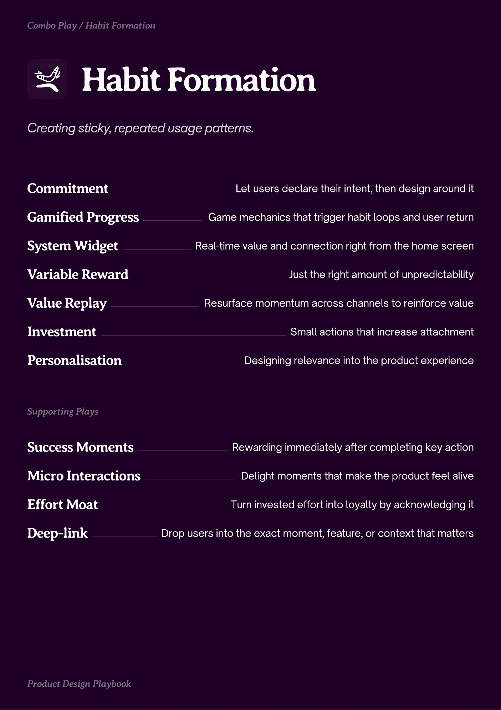
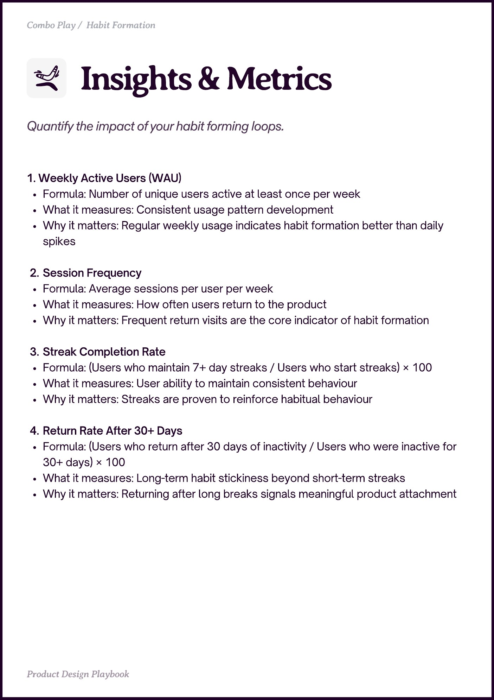
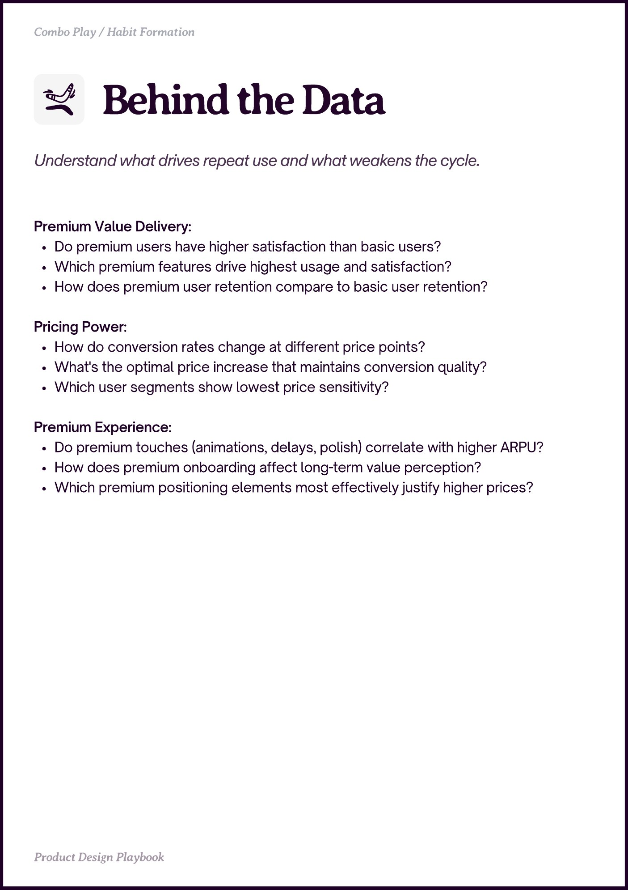

# Habit Formation


Source-faithful grouping of PDF pages 36 through 38.


## Play stack, PDF page 36

[Open extracted page text](../source/pages/page-036.md) | [Open full-page screenshot](../screenshots/page-036.jpg)



### Extracted text

```text
abit ormation

Commitment
Gamified Progress
System Widget
Variable Reward
Value Replay
Investment
Personalisation

Let users declare their intent, then design around it
Game mechanics that trigger habit loops and user return
Real-time value and connection right from the home screen
Just the right amount of unpredictability
Resurface momentum across channels to reinforce value
Small actions that increase attachment
Designing relevance into the product experience

Success Moments

Rewarding immediately after completing key action

Micro Interactions

Delight moments that make the product feel alive

Effort Moat
Deep-link

Turn invested effort into loyalty by acknowledging it
Drop users into the exact moment, feature, or context that matters
```

## Insights and metrics, PDF page 37

[Open extracted page text](../source/pages/page-037.md) | [Open full-page screenshot](../screenshots/page-037.jpg)



### Extracted text

```text
Combo Play / Habit Formation

1. Weekly Active Users (WAU)

Formula: Number of unique users active at least once per week

What it measures: Consistent usage pattern development

Why it matters: Regular weekly usage indicates habit formation better than daily
spikes


Session Frequency

Formula: Average sessions per user per week

What it measures: How often users return to the product

Why it matters: Frequent return visits are the core indicator of habit formation


Streak Completion Rate

Formula: (Users who maintain 7+ day streaks / Users who start streaks) × 100

What it measures: User ability to maintain consistent behaviour

Why it matters: Streaks are proven to reinforce habitual behaviour


Return Rate After 30+ Days

Formula: (Users who return after 30 days of inactivity / Users who were inactive for
30+ days) × 100

What it measures: Long-term habit stickiness beyond short-term streaks

Why it matters: Returning after long breaks signals meaningful product attachment

Prot in Playboo
```

## Behind the data, PDF page 38

[Open extracted page text](../source/pages/page-038.md) | [Open full-page screenshot](../screenshots/page-038.jpg)



### Extracted text

```text
Combo Play / Habit Formation

Premium Value Delivery:

Do premium users have higher satisfaction than basic users?

Which premium features drive highest usage and satisfaction?

How does premium user retention compare to basic user retention?


Pricing Power:

How do conversion rates change at different price points?

What's the optimal price increase that maintains conversion quality?

Which user segments show lowest price sensitivity?


Premium Experience:

Do premium touches (animations, delays, polish) correlate with higher ARPU?

How does premium onboarding affect long-term value perception?

Which premium positioning elements most effectively justify higher prices?

Prot in Playboo
```
