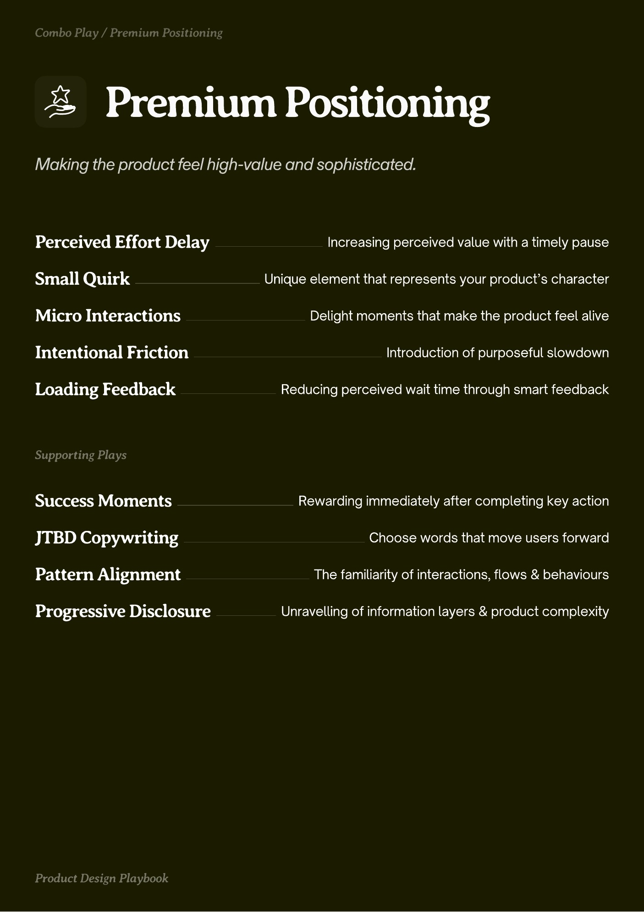
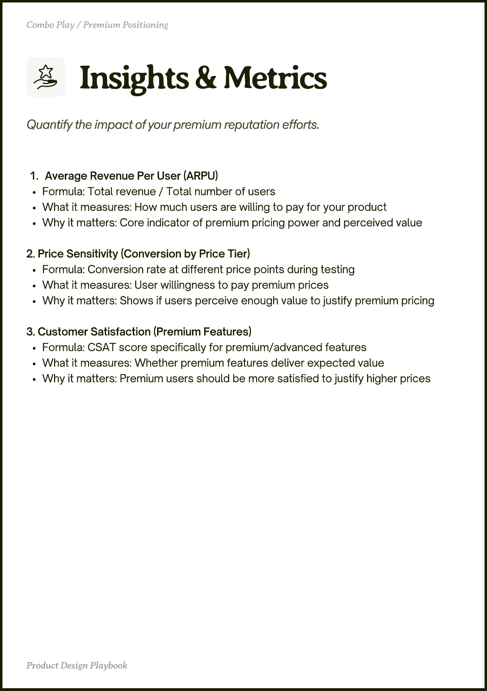
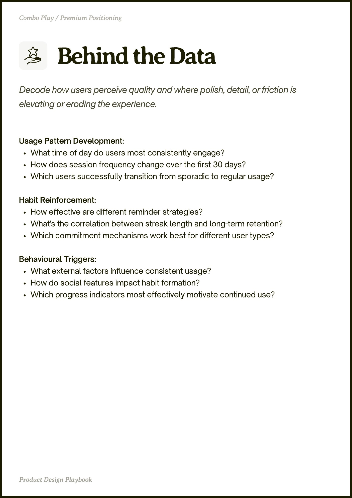

# Premium Positioning


Source-faithful grouping of PDF pages 39 through 41.


## Play stack, PDF page 39

[Open extracted page text](../source/pages/page-039.md) | [Open full-page screenshot](../screenshots/page-039.jpg)



### Extracted text

```text
Premium Positioning

Perceived Effort Delay
Small Quirk
Micro Interactions
Intentional Friction

Increasing perceived value with a timely pause

Unique element that represents your product’s character

Delight moments that make the product feel alive

Introduction of purposeful slowdown

Loading Feedback

Reducing perceived wait time through smart feedback

Success Moments

Rewarding immediately after completing key action

JTBD Copywriting

Choose words that move users forward

Pattern Alignment

The familiarity of interactions, flows & behaviours

Progressive Disclosure

Unravelling of information layers & product complexity
```

## Insights and metrics, PDF page 40

[Open extracted page text](../source/pages/page-040.md) | [Open full-page screenshot](../screenshots/page-040.jpg)



### Extracted text

```text
Average Revenue Per User (ARPU)

Formula: Total revenue / Total number of users

What it measures: How much users are willing to pay for your product

Why it matters: Core indicator of premium pricing power and perceived value


2. Price Sensitivity (Conversion by Price Tier)

Formula: Conversion rate at different price points during testing

What it measures: User willingness to pay premium prices

Why it matters: Shows if users perceive enough value to justify premium pricing


3. Customer Satisfaction (Premium Features)

Formula: CSAT score specifically for premium/advanced features

What it measures: Whether premium features deliver expected value

Why it matters: Premium users should be more satisfied to justify higher prices
```

## Behind the data, PDF page 41

[Open extracted page text](../source/pages/page-041.md) | [Open full-page screenshot](../screenshots/page-041.jpg)



### Extracted text

```text
Usage Pattern Development:

What time of day do users most consistently engage?

How does session frequency change over the first 30 days?

Which users successfully transition from sporadic to regular usage?


Habit Reinforcement:

How effective are different reminder strategies?

What's the correlation between streak length and long-term retention?

Which commitment mechanisms work best for different user types?


Behavioural Triggers:

What external factors influence consistent usage?

How do social features impact habit formation?

Which progress indicators most effectively motivate continued use?
```
