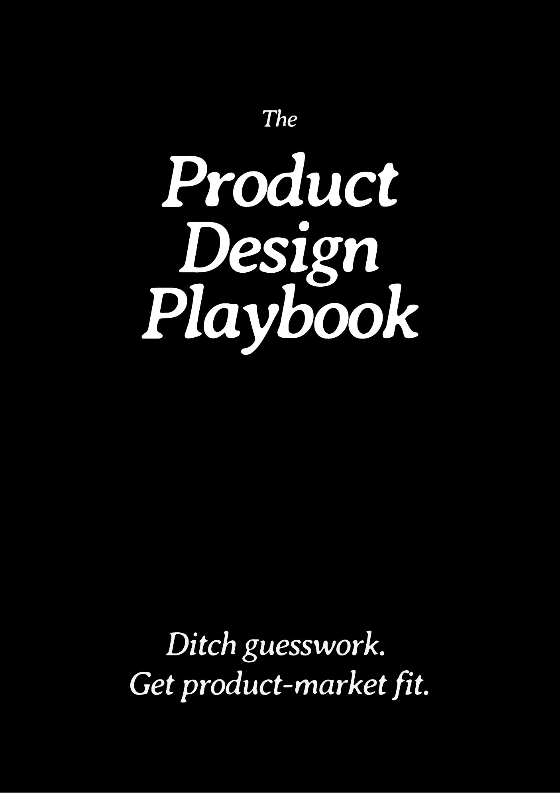
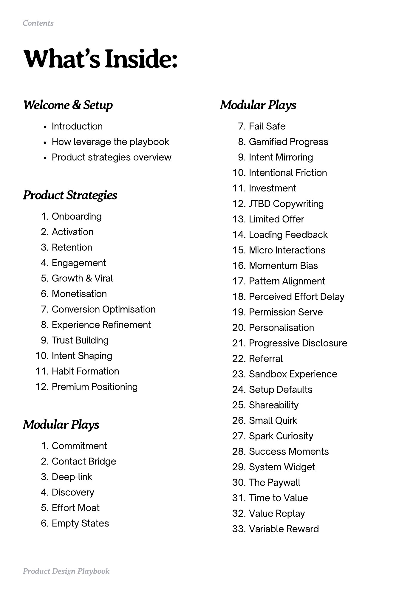
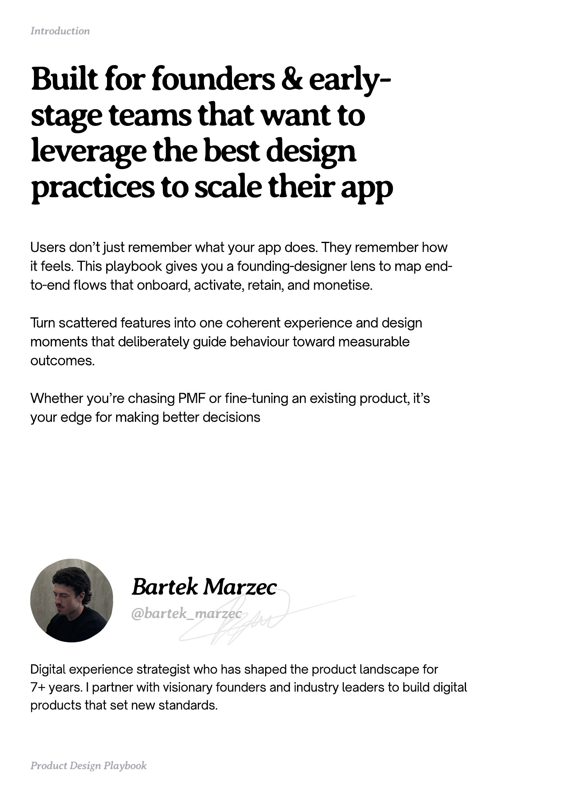
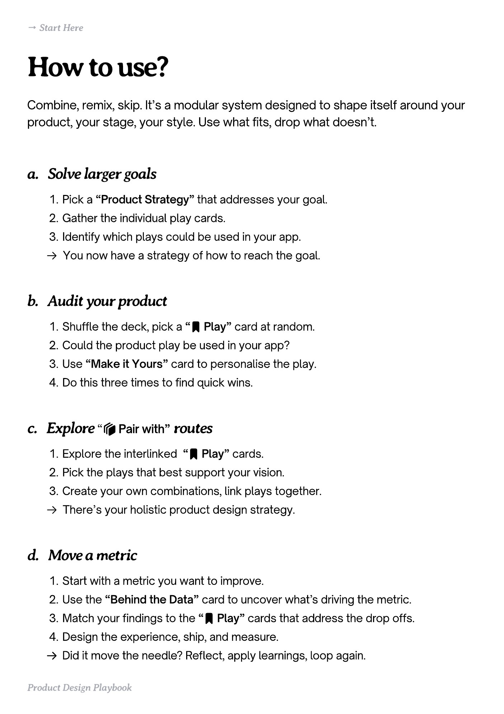
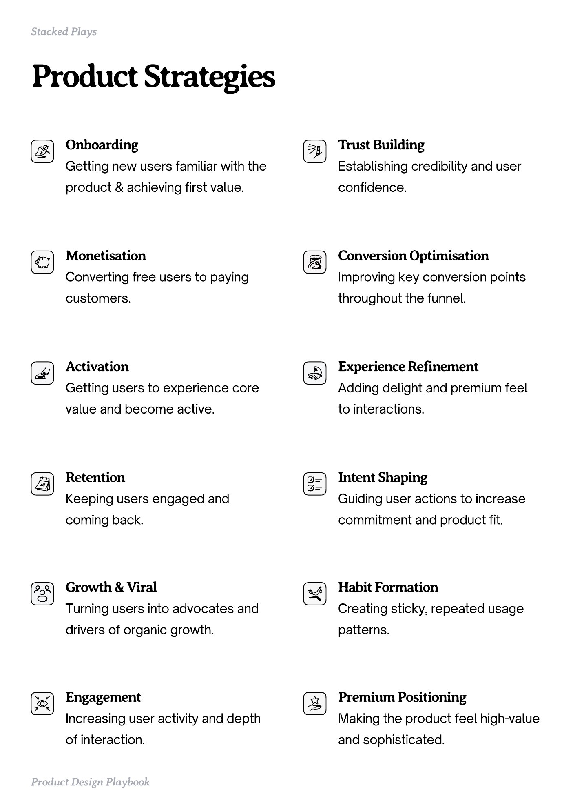

# Welcome and setup


Source-faithful grouping of PDF pages 1 through 5. The page screenshots preserve layout, imagery, and any text that the PDF text layer could not recover.


## Cover, PDF page 1

[Open extracted page text](source/pages/page-001.md) | [Open full-page screenshot](screenshots/page-001.jpg)



### Extracted text

```text
Product

Design

Playbook
```

## Contents, PDF page 2

[Open extracted page text](source/pages/page-002.md) | [Open full-page screenshot](screenshots/page-002.jpg)



### Extracted text

```text
Contents

What’s Inside:
Welcome & Setup
Introduction


Modular Plays
Fail Safe


How leverage the playbook


Gamified Progress


Product strategies overview

Intent Mirroring

Intentional Friction


Product Strategies
Onboarding

Activation

Retention

Engagement

Growth & Viral

Monetisation

Conversion Optimisation

Experience Refinement

Trust Building

Intent Shaping

Habit Formation

Premium Positioning

Investment

JTBD Copywriting

Limited Offer

Loading Feedback

Micro Interactions

Momentum Bias

Pattern Alignment

Perceived Effort Delay

Permission Serve

Personalisation

Progressive Disclosure

Referral

Sandbox Experience

Setup Defaults

Shareability


Modular Plays

Small Quirk

Spark Curiosity


Commitment

Contact Bridge

Deep-link

Discovery

Effort Moat

Empty States

Product Design Playbook

Success Moments

System Widget

The Paywall

Time to Value

Value Replay

Variable Reward
```

## Introduction, PDF page 3

[Open extracted page text](source/pages/page-003.md) | [Open full-page screenshot](screenshots/page-003.jpg)



### Extracted text

```text
Introduction

Built for founders & earlystage teams that want to
leverage the best design
practices to scale their app
Users don’t just remember what your app does. They remember how
it feels. This playbook gives you a founding-designer lens to map endto-end flows that onboard, activate, retain, and monetise. 


Turn scattered features into one coherent experience and design
moments that deliberately guide behaviour toward measurable
outcomes. 


Whether you’re chasing PMF or fine-tuning an existing product, it’s
your edge for making better decisions

Bartek Marzec
@bartek_marzec

Digital experience strategist who has shaped the product landscape for 

7+ years. I partner with visionary founders and industry leaders to build digital
products that set new standards.

Product Design Playbook
```

## How to use the playbook, PDF page 4

[Open extracted page text](source/pages/page-004.md) | [Open full-page screenshot](screenshots/page-004.jpg)



### Extracted text

```text
→ Start Here

How to use?
Combine, remix, skip. It’s a modular system designed to shape itself around your
product, your stage, your style. Use what fits, drop what doesn’t.

a. Solve larger goals
Pick a “Product Strategy” that addresses your goal.

Gather the individual play cards.

Identify which plays could be used in your app.

􀰑 You now have a strategy of how to reach the goal.

b. Audit your product
Shuffle the deck, pick a “􀉟 Play” card at random.

Could the product play be used in your app?

Use “Make it Yours” card to personalise the play.

Do this three times to find quick wins.

c. Explore “􀰴 Pair with” routes
Explore the interlinked “􀉟 Play” cards.

Pick the plays that best support your vision.

Create your own combinations, link plays together.

􀰑 There’s your holistic product design strategy.

d. Move a metric
Start with a metric you want to improve.

Use the “Behind the Data” card to uncover what’s driving the metric.

Match your findings to the “􀉟 Play” cards that address the drop offs.

Design the experience, ship, and measure.

􀰑 Did it move the needle? Reflect, apply learnings, loop again.
Product Design Playbook
```

## Product strategies overview, PDF page 5

[Open extracted page text](source/pages/page-005.md) | [Open full-page screenshot](screenshots/page-005.jpg)



### Extracted text

```text
Stacked Plays

Product Strategies
Onboarding


Trust Building


Getting new users familiar with the

Establishing credibility and user

product & achieving first value.

confidence.

Monetisation


Conversion Optimisation


Converting free users to paying

Improving key conversion points

customers.

throughout the funnel.

Activation


Experience Refinement


Getting users to experience core

Adding delight and premium feel

value and become active.

to interactions.

Retention


Intent Shaping


Keeping users engaged and

Guiding user actions to increase

coming back.

commitment and product fit.

Growth & Viral


Habit Formation


drivers of organic growth.

patterns.

Engagement


Premium Positioning


Turning users into advocates and

Creating sticky, repeated usage

Increasing user activity and depth

Making the product feel high-value

of interaction.

and sophisticated.

Product Design Playbook
```
