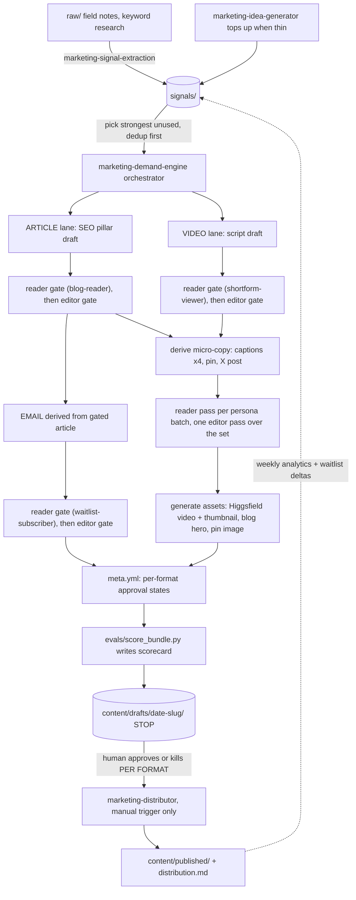

# Workflow · demand engine

The end-to-end map of the pipeline. This file names the skills it chains, it
never re-explains their steps: each skill's `SKILL.md` owns its own how, each
routine file owns its own when. Spec: `docs/homa-planning/14-marketing-demand-engine.md`.

## The map

## Steps and status

Status values: `works` (runnable today) · `staged-only` (produces the artifact,
cannot ship it yet) · `blocked-on-human` (named human steps required) ·
`disabled` (built, deliberately off).

| # | Step | Skill | Status |
|---|---|---|---|
| 1 | Extract raw into atomic sourced signals | `marketing-signal-extraction` | works |
| 2 | Top up the reservoir when thin | `marketing-idea-generator` | works |
| 3 | Orchestrate one bundle end to end | `marketing-demand-engine` | works |
| 4 | Reader gate (persona role-play, notes only) | `marketing-copy-reviewer` | works |
| 5 | Editor gate (house style, notes only) | `marketing-copy-editor` | works |
| 6 | Draft the SEO pillar article | `marketing-article-writer` | works |
| 7 | Script + generate the shortform video | `marketing-video-producer` | works (Higgsfield CLI authed) |
| 8 | Derive the waitlist nurture email | `marketing-email-writer` | staged-only (DM7 consent ruling open, spec §10) |
| 9 | Blog hero, figures, pin image | `marketing-illustrator` | works |
| 10 | Publish approved formats: blog | `marketing-distributor` | works (git is the channel) |
| 11 | Publish approved formats: TikTok, Instagram, Pinterest, Facebook, YouTube, X | `marketing-distributor` | blocked-on-human: register @thankshoma handles, create the YouTube channel, connect each account in Postiz, run `postiz auth:login` (HUMAN-TODO) |
| 12 | Send the email | `marketing-distributor` | blocked-on-human: founder ruling DM7 (HUMAN-TODO) |
| 13 | Weekly analytics into reports + engagement signals | `marketing-engagement-loop` | staged-only until first social publishes; waitlist deltas work now |
| 14 | Reservoir hygiene + scorecard trends | `marketing-janitor` | works |
| 15 | Nightly staging run, 04:00 ET | `routines/nightly-content.md` | disabled (DM4, manual-first) |
| 16 | Monday engagement run | `routines/weekly-engagement.md` | disabled (DM4) |

Update the status column when reality changes (a handle gets connected, DM7 gets
ruled, a routine gets enabled). This table is the honest state of the engine.
