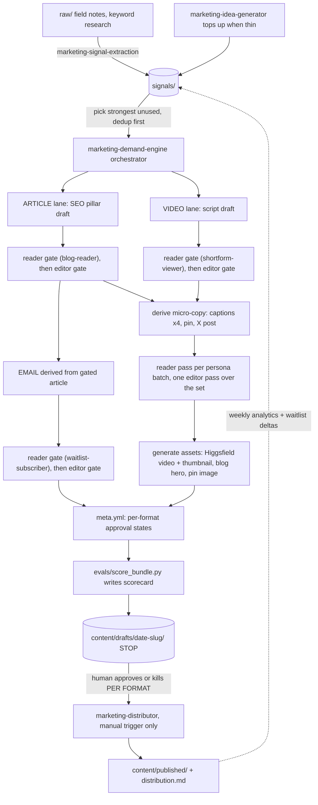

# Workflow · demand engine

The end-to-end map of the pipeline. This file names the skills it chains, it
never re-explains their steps: each skill's `SKILL.md` owns its own how, each
routine file owns its own when. Spec: `docs/homa-planning/14-marketing-demand-engine.md`.

## The map

## Steps and status

Status is evidence-scoped and dated 2026-07-11. `local-only` means the skill
and its local inputs exist but no end-to-end run was verified in this audit.
`staged-only` means an external account is reachable but no current output or
delivery was verified. `blocked-on-human` names the missing decision or account
step. `disabled` means the schedule is deliberately off and not installed.

| # | Step | Skill | Status |
|---|---|---|---|
| 1 | Extract raw into atomic sourced signals | `marketing-signal-extraction` | local-only; not run in this audit |
| 2 | Top up the reservoir when thin | `marketing-idea-generator` | local-only; not run in this audit |
| 3 | Orchestrate one bundle end to end | `marketing-demand-engine` | local-only; no current complete bundle run verified |
| 4 | Reader gate (persona role-play, notes only) | `marketing-copy-reviewer` | local-only; instruction present |
| 5 | Editor gate (house style, notes only) | `marketing-copy-editor` | local-only; instruction present |
| 6 | Draft the SEO pillar article | `marketing-article-writer` | local-only; no approved article exists |
| 7 | Script + generate the shortform video | `marketing-video-producer` | staged-only; Higgsfield account access verified, generation unverified |
| 8 | Derive the legacy-waitlist nurture email | `marketing-email-writer` | blocked-on-human: DM7 consent ruling open |
| 9 | Blog hero, figures, pin image | `marketing-illustrator` | staged-only; Higgsfield account access verified, generation unverified |
| 10 | Publish approved formats: blog | `marketing-distributor` | local-only; current skill stops after local copy, build, and commit, so push, READY, and live probe are unverified |
| 11 | Publish approved formats: TikTok, Instagram, Pinterest, Facebook, YouTube, X | `marketing-distributor` | blocked-on-human: register @thankshoma handles, create the YouTube channel, connect each account in Postiz, run `postiz auth:login` (HUMAN-TODO) |
| 12 | Send the email | `marketing-distributor` | blocked-on-human: DM7; Resend delivery was not verified |
| 13 | Weekly analytics into reports + engagement signals | `marketing-engagement-loop` | blocked-on-human: no published social data, Postiz unauthenticated, waitlist data not inspected |
| 14 | Reservoir hygiene + scorecard trends | `marketing-janitor` | local-only; instruction present, not run in this audit |
| 15 | Nightly staging run, 04:00 ET | `routines/nightly-content.md` | disabled; no scheduler installed |
| 16 | Monday engagement run | `routines/weekly-engagement.md` | disabled; no scheduler installed |

Update the status column only after recording the matching local command,
provider, deployment, or data evidence. Repository presence alone does not
promote a row to working.
